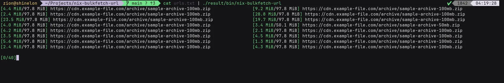

# nix-bulkfetch-url

Fetch URLs and print their hashes in parallel, without touching the Nix store.

<div align="center">
  
</div>

## Features

- Worker pool size set with `-j`, 16 concurrent downloads by default
- Failed downloads retried 3 times with exponential backoff
- `--fail-fast` aborts the run on the first error
- One statically linked binary, no Go dependencies

## Install

Run it without installing:

```bash
nix run github:z1-0/nix-bulkfetch-url
```

Or install it into your profile:

```bash
nix profile install github:z1-0/nix-bulkfetch-url
```

### As a flake input

Add it to your `flake.nix`:

```nix
inputs.nix-bulkfetch-url.url = "github:z1-0/nix-bulkfetch-url";
```

On NixOS, add the package in `configuration.nix`:

```nix
environment.systemPackages = [
  inputs.nix-bulkfetch-url.packages.${pkgs.system}.default
];
```

With Home Manager, add it in `home.nix`:

```nix
home.packages = [
  inputs.nix-bulkfetch-url.packages.${pkgs.system}.default
];
```

## Dependencies

The binary has no Go dependencies and is statically linked. Unpacking shells out to
these tools:

| Format                | Tool               |
| --------------------- | ------------------ |
| `.tar.gz`, `.tgz`     | `tar`              |
| `.tar.xz`, `.txz`     | `tar`              |
| `.tar.bz2`, `.tbz2`   | `tar`              |
| `.tar.zst`, `.tzst`   | `tar` + `zstd`     |
| `.tar.lzma`, `.tlzma` | `tar`              |
| `.tar.lz`, `.tlz`     | `tar` + `lzip`     |
| `.tar.lz4`, `.tlz4`   | `tar` + `lz4`      |
| `.tar.lzo`, `.tlzo`   | `tar` + `lzop`     |
| `.tar.Z`, `.tZ`       | `tar` + `compress` |
| `.zip`                | `unzip`            |

## Usage

`nix-bulkfetch-url` reads URLs from stdin, one per line: the same shape as a `wget -i`
file or an IANA `text/uri-list` ([RFC 2483](https://www.rfc-editor.org/rfc/rfc2483)). Only
`http://` and `https://` work. Blank lines and lines starting with `#` are skipped, and LF
or CRLF both parse.

```bash
echo "https://example.com/archive.tar.gz" | nix-bulkfetch-url
```

There are no positional arguments, so `nix-bulkfetch-url urls.txt` is an error. Pass the
list through a pipe or a redirect (`< urls.txt`).

### Flags

| Flag          | Default  | Description                                                 |
| ------------- | -------- | ----------------------------------------------------------- |
| `-j`          | `16`     | Concurrent workers                                          |
| `--type`      | `sha256` | Hash algorithm: `md5`, `sha1`, `sha256`, `sha512`, `blake3` |
| `--format`    | `sri`    | Output format: `base16`, `base32`, `base64`, `sri`          |
| `--unpack`    | `false`  | Unpack archive and compute NAR hash                         |
| `--json`      | `false`  | Output as JSON                                              |
| `--timeout`   | `300`    | Timeout for each download attempt (seconds)                 |
| `--fail-fast` | `false`  | Exit on first error                                         |

### Exit codes

| Code | Meaning                                   |
| ---- | ----------------------------------------- |
| `0`  | All URLs succeeded                        |
| `1`  | Some failed, some succeeded               |
| `2`  | Nothing succeeded, no input, or bad usage |

## Examples

### Hash a single URL

```bash
echo "https://github.com/user/repo/archive/v1.0.0.tar.gz" | nix-bulkfetch-url
```

### Batch hash every URL in a file

```bash
nix-bulkfetch-url -j 8 --json < urls.txt        # redirect
cat urls.txt | nix-bulkfetch-url -j 8 --json    # pipe, identical
```

### Unpack and compute NAR hash

`--unpack` downloads each archive, extracts it, and hashes the unpacked directory as a
NAR, which is the hash you put in a Nix derivation's `sha256` field.

The extractor comes from the archive extension in the URL path, so a URL like
`.../download?id=42` fails with `unsupported archive format`.

```bash
nix-bulkfetch-url --unpack < urls.txt
```

### Pipe URLs from a script

```bash
grep -oP 'https://[^\s"]+\.tar\.gz' packages.nix | nix-bulkfetch-url --type blake3
```

### JSON output for scripting

```bash
nix-bulkfetch-url --json < urls.txt | jq '.[] | select(.error == null)'
```

## How it works

1. Read URLs from stdin.
2. Download them concurrently through a worker pool of N goroutines.
3. For each URL: fetch into a temp directory, unpack when `--unpack` is set, then hash with `nix-hash`.
4. Print one hash per line, or a JSON array with `--json`.
